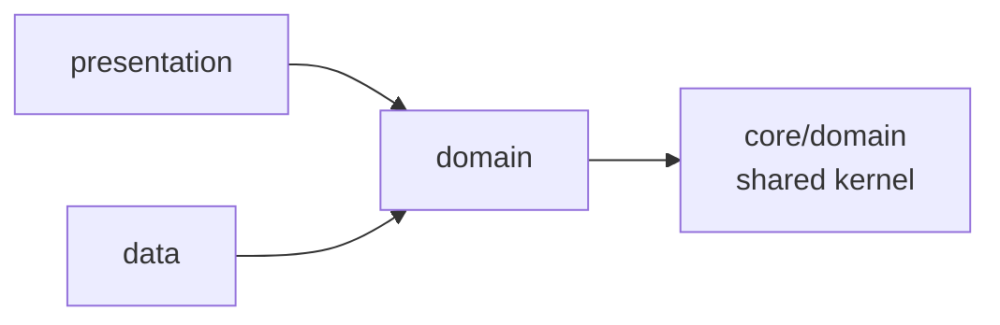

# Evangelion

[](https://github.com/fadyphil/evangelion/actions/workflows/ci.yml)
[](LICENSE)
[](ROADMAP.md#status)
[](ROADMAP.md#status)
[](pubspec.yaml)
[](pubspec.yaml)
[](docs/BACKEND-VERIFICATION.md)

A bilingual Flutter client for Sunday-School daily Bible reading — Arabic in
Smith & Van Dyck, English in the NKJV. Seven screens, a dark glassmorphic design
system, and a verification regime built around the idea that **a gate which
cannot fail is worse than no gate**.

This repository is the **client only**. The backend is a separate project, and
this repository treats it as read-only reference material.

> [!IMPORTANT]
> [`docs/agents/AGENT_CONTEXT.md`](docs/agents/AGENT_CONTEXT.md) is the single
> source of truth for scope, architecture and standards. **It wins over every
> other document in this repository, including this file.** Where the two
> disagree, that document is right and this one is stale.

---

## Contents

- [What it is](#what-it-is)
- [Screens](#screens)
- [Quick start](#quick-start)
- [Architecture](#architecture)
- [Project layout](#project-layout)
- [The seven gates](#the-seven-gates)
- [Testing](#testing)
- [Design system](#design-system)
- [Localization](#localization)
- [Running the backend](#running-the-backend)
- [Documentation](#documentation)
- [Roadmap](#roadmap)
- [Contributing](#contributing)
- [License](#license)

---

## What it is

Evangelion is a daily-reading app for a Sunday-School congregation. A reader
opens the app, reads today's passage in either language, answers a reflection
question, and sees their streak update.

Three things about it are worth knowing before you read any code.

**It is bilingual, and the two arms are not translations of each other.** Arabic
renders in Smith & Van Dyck, English in the NKJV, and the decision of which
corpus to show is the server's — the client reads the `language` field the
response carried and follows it. Typography, pluralization and layout all branch
on that.

**Four of the seven screens read live data; three do not.** Reading, quiz,
result and the leaderboard come from a REST API. Login is UI-only against a
fake repository because the backend has no auth endpoint. Settings are local to
the device with no server sync.

**The verification regime is unusual and deliberate.** `dart analyze` runs with
`--fatal-infos --fatal-warnings`, there are **no** `// ignore:` comments in
hand-written code, and seven gates are wired into a single command with a
recorded coverage floor. The reasoning is in
[ADR-0020](docs/adr/0020-a-gate-that-cannot-fail-is-worse-than-no-gate.md), and
it is the most distinctive engineering decision in the repository.

---

## Screens

Seven screens, seven routes, and a catch-all redirect. The screen count in the
authority document is stale — see [ROADMAP.md § Docs debt](ROADMAP.md#docs-debt-findings-from-re-measurement).

| Route | Screen | Data source |
| --- | --- | --- |
| `/login` | Onboarding and sign-in | `FakeAuthRepository` — **no auth endpoint exists** |
| `/` | Home — greeting, streak flame, today's reading | **API** — two endpoints |
| `/reading` | Reading sanctuary, EN and AR, zero chrome | **API** |
| `/quiz` | Reflection questions with per-answer feedback | **API** |
| `/result` | Score, streak, stat tiles | **API** — the submit response, held in memory |
| `/settings` | Appearance, reading, about | Local — `shared_preferences` |
| `/leaderboard` | Cohort ranking | **API**, or a stub via `--dart-define` |

Four of these are deliberately inert and say so in their own accessible names —
"unavailable in this build" — rather than pretending to work. There is no
passage library and no user profile, because the backend has no endpoints for
either. See [ADR-0001](docs/adr/0001-six-screens-library-and-profile-cut.md).

`/result` is **not deep-linkable**, and that is deliberate rather than a bug: the
submit response exists only as the reply to a `POST`, so `ResultPage` takes it as
a required constructor parameter. See
[ADR-0015](docs/adr/0015-result-is-not-deep-linkable.md).

---

## Quick start

You need Flutter **3.47.4** and Dart **3.13.3** on stable. There is no FVM and no
melos. You also need `rg` (ripgrep) and Python 3 for the verification gates.

```bash
# 1. Install dependencies
flutter pub get

# 2. Point the app at a backend (defaults to http://localhost:3000)
flutter run -d linux
flutter run -d linux --dart-define=API_BASE_URL=http://localhost:3000
```

Four of the seven screens need a running backend. See
[Running the backend](#running-the-backend) — there are two environment traps
there that each cost an afternoon if you meet them cold.

> [!TIP]
> **`flutter test`, never `dart test`.** The plain Dart VM has no `dart:ui` and
> cannot compile Flutter SDK sources, so `dart test` fails to load *every* test
> file, including the pure-Dart ones.
---
> [!NOTE]
> **If the app aborts with `GLib-GIO-ERROR … 'xsettings' does not contain a key
> named 'antialiasing'`**, the app built and launched — that is an environment
> fault, not a code fault. Check `echo $GSETTINGS_SCHEMA_DIR`. If it points into a
> snap directory, run `GSETTINGS_SCHEMA_DIR=/usr/share/glib-2.0/schemas flutter
> run -d linux`.

---

## Architecture

Dependency direction is strictly inward. `domain` imports nothing from `data`
and nothing from Flutter.



Three layers, and the direction is mechanically enforced rather than reviewed:

| Layer | Directory | May import | Must never import |
| --- | --- | --- | --- |
| `domain` | `core/domain/`, `features/*/domain/` | pure Dart only | Flutter, Dio, HTTP |
| `data` | `features/*/data/` | `domain` | the presentation layer |
| `presentation` | `features/*/presentation/` | `domain` | another feature |

**The placement test** decides where a new type goes: used by exactly one
feature → that feature's `domain/`; used by two or more → `core/domain/`.
Nothing enters the shared kernel speculatively. Without it, three screens that
each need `ReadingRepository` would force cross-feature imports and break the
gate.

**Five repository ports** live in `core/domain/repositories/`, and every adapter
registers *against the port* so no bloc or page ever names a concrete class. The
rule for a future port: if it ever ends up with a single adapter that nothing
substitutes, delete it.

**Errors are values, not exceptions.** `Result<T>` is a typedef for
`Either<Failure, T>` over `fpdart`, whose `Either` is `sealed` — so a `switch`
over a result is an exhaustive switch expression with no `default` arm, and a
third arm breaks the build of every file that switches on it. Nothing in `lib/`
throws across a repository boundary.

**No feature imports another feature.** Shared UI lives in
`core/design_system/`; shared domain lives in `core/domain/`.

[`docs/ARCHITECTURE.md`](docs/ARCHITECTURE.md) is the map and
[`docs/SEAMS.md`](docs/SEAMS.md) is the depth — seven seams where the answer to
a question changes shape.

---

## Project layout

```tree
lib/
  main.dart              bootstrap
  app/                   composition root: DI, router
    di/                  injection.dart (generated) + navigation_injection.dart
    router/              AppRouter, AuthGuard, generated routes
  core/
    common/              Result<T>, Failure, AppConfig          pure Dart
    design_system/       tokens, theme, effects, 23 widgets
    domain/              SHARED KERNEL: entities + 5 ports       pure Dart
    navigation/          route constants, AuthStatus             pure Dart
    network/             Dio client, interceptors, error mapper
  features/
    auth/  home/  leaderboard/  quiz/  reading/  result/  settings/
      domain/            this feature's use cases only          pure Dart
      data/              data sources, mappers, repository adapters
      presentation/      bloc or cubit, pages, widgets
  l10n/                  ARB sources and generated localizations

tool/                    verification: verify_all.sh, verify_purity.sh, gates/
docs/                    architecture, seams, drift, ADRs, the port plan
eva/                     the React design prototype — read-only reference
test/                    157 files, 2507 tests, 148 goldens
```

---

## The seven gates

Everything the repository asserts about itself is checked by a command that can
fail. One command runs all of them, in cost order, so a formatting error takes
two seconds to find rather than the minute the test suite takes.

```bash
tool/verify_all.sh                    # the seven fast gates
tool/verify_all.sh --with-build       # + the Linux build gate (slow, wipes build/)
tool/verify_all.sh --update-baseline  # re-record the coverage floor
```

| # | Gate | Command | A failure means |
| --- | --- | --- | --- |
| 1 | Format | `dart format --output=none --set-exit-if-changed lib test tool` | Not formatted. Run `dart format lib test tool`. Nothing else matters until this passes. |
| 2 | Analyze | `dart analyze --fatal-infos --fatal-warnings` | A type error, a lint, or a deprecated API. This one command enforces all three. |
| 3 | Architecture | `tool/verify_purity.sh` | A pure-Dart directory reached Flutter, Dio or HTTP; a feature imported another feature; a generated file lost its ignore header; a route constant stopped being a plain literal. |
| 4 | Citations and reachability | `python3 tool/gates/citation_check.py` and `python3 tool/gates/orphan_widget_check.py` | A prototype citation points at a line that no longer says what it said, or a design-system widget is built and tested but no page instantiates it. |
| 5 | Fixable APIs | `dart fix --dry-run` | Deprecated or lint-fixable usage remains. **This command exits `0` even with work to do** — its output is the check, not its exit code. |
| 6 | Test suite | `flutter test` | A behaviour changed, or a test is flaky. |
| 7 | Coverage and the floor | `flutter test --coverage` | Line coverage or test count fell below the recorded floor in `tool/baseline/gates.txt`. |
| 8 | Linux build (opt-in) | `tool/verify_linux_build.sh` | The app does not really build. |

The script distinguishes three outcomes, and the third is the point:

| Outcome | Meaning | Exit |
| --- | --- | --- |
| `ok` | The gate ran and passed. | — |
| `FAIL` | The gate ran and found something. | `1` |
| `FATAL` | The gate **could not run** — a missing tool, a broken `rg`. | `2` |

A gate that could not run is never a pass. That distinction exists because this
repository has a recorded history of gates reporting clean runs over surfaces
they never examined, and
[`docs/DRIFT.md`](docs/DRIFT.md) is the catalogue of what rotted instead.

---

## Testing

**2507 tests, 98.39 % line coverage**, and the analyzer reports no issues. All
three numbers are produced by `tool/verify_all.sh`.

The split between test-first and test-alongside is deliberate:

| Domain logic | Widget and screen work |
| --- | --- |
| **Red-first.** Entities, `Result`/`Failure`, use cases, mappers, the error mapper, the header interceptor, repositories, token tables, **every cubit** via `bloc_test` + `mocktail`. | **Not red-first.** Behaviour, widget and golden tests written alongside the widget. UI is explicitly exempt from a test-first ceremony. |

The exemption has one hard edge: **domain logic must not be buried inside a
widget.** If a widget needs a conditional or a calculation, extract it to a cubit
or a pure function and test-drive that. A widget that computes a streak inline is
untested logic wearing a `build` method, and no gate here can see it. See
[ADR-0021](docs/adr/0021-tdd-for-domain-and-behaviour-tests-for-widgets.md).

Goldens and prototype citations are a **coupled pair**. Re-recording a golden
without re-checking the `eva/` citation it encodes is a review failure.

---

## Design system

A dark glassmorphic system with **23 widgets** and **8 token files**, built from
a React prototype in `eva/` that is treated as read-only reference material. Five
font families are bundled as static TTFs — Cormorant Garamond, EB Garamond, DM
Sans, Amiri and Space Mono — so goldens resolve offline and Flutter never resorts
to synthetic bolding.

Three properties are worth knowing before reading the token files:

- **All elevations are `0`, by decision.** The design specification has no
  elevation table and the prototype has no z-axis, so "no Material elevation
  anywhere" is the faithful reading. Layering is carried by `line`, the glass
  triple, and one ambient shadow.
- **The accent splits into a fill and an ink**, and only the light values differ.
  One value cannot do both jobs: as a fill it must stay light enough that the ink
  reads on it, and as text on a pale surface it must clear 4.5:1. Light `ember`
  measures 2.11:1 as text, which is why the ink is a separate token.
- **Amiri is the only bundled family that renders Arabic.** Four strings reached
  a shipped screen in a Latin-only face and every glyph rendered as tofu — found
  by a gate the moment the component was *placed* on a screen, not when it was
  tested in English.

Performance has a budget with teeth: **one blur site per screen** and **three
animation controllers app-wide**, published through a scope rather than per orb.
See [ADR-0019](docs/adr/0019-performance-budget.md).

A **major UI overhaul is planned** and these four decisions are marked
`accepted — under review`. See
[ROADMAP.md § Design overhaul](ROADMAP.md#design-overhaul).

---

## Localization

ARB plus `gen_l10n`, with **111 keys per locale** in `lib/l10n/`. Every key is
prefixed by its feature. ICU plurals are used where counts appear, which matters
more than it sounds: Arabic has six plural forms, and a hand-rolled table
rendered `٢ أسئلة` where correct Arabic is `٢ سؤالان`.

Three facts that are not obvious:

- **A missing key is a warning, not a build error.** `flutter gen-l10n` prints a
  hint, exits `0`, and emits the template's English value into the Arabic class.
  A structural test over the two ARB files is what turns it red.
- **`build_runner` does not produce the localization files.** `dart run
  build_runner build` produces the freezed, auto_route and injectable outputs
  and does *not* run `gen_l10n`. Only `flutter gen-l10n`, `flutter pub get` and
  `flutter build` do — and not `flutter test`. The generated files are committed
  and committed *formatted*, because the raw output is not `dart format`-clean.
- **The Arabic family is resolved by two mechanisms answering two different
  questions**: payload content follows the language the server sent, and the
  app's own chrome follows the ambient locale. They are different facts and are
  kept apart deliberately. See
  [ADR-0018](docs/adr/0018-bilingual-typography-two-arms-two-questions.md).

---

## Running the backend

The backend is a **separate project** in a sibling checkout, and this repository
must never modify it.

```bash
cd <path-to>/EvangelionBackend
NODE_ENV=development PORT=3000 node dist/server.js
```

> [!WARNING]
> **`NODE_ENV` must not be `test`.** The in-memory Redis fallback pre-seeds the
> leaderboard only when `NODE_ENV` is not `test`, so a server started that way
> answers with an empty leaderboard — and you will conclude the endpoint is
> broken.
---
> [!WARNING]
> **Background it with `setsid … & disown`.** A plain `&` is killed when the
> calling shell exits, and every request then returns `000`, which reads exactly
> like a server fault.

No Postgres or Redis is required; both fall back to in-memory.

### The contract, and its traps

Four endpoints are used, and identity is three headers — `X-User-Id`,
`X-Group-Id` and `X-User-Role`. Two of those are load-bearing in ways that
surprise:

- **`X-User-Id` is not authenticated.** The server checks that it is present and
  non-empty, and nothing else. A non-UUID value is accepted with a `200` and
  echoed back. Any deployment of this client needs a real authenticating proxy
  in front of the API. See [`SECURITY.md`](SECURITY.md).
- **`X-User-Role` is parsed and never checked.** Never gate UI on it expecting
  server enforcement.

The traps the client is written to handle are documented with live measurements
in [`docs/BACKEND-VERIFICATION.md`](docs/BACKEND-VERIFICATION.md). The sharpest
one: **the backend disagrees with itself about what "today" means.** Two
endpoints, read in the same minute, report different streaks and different
completion for the same reader. The client's answer is that each field comes
from the endpoint whose job it is and the two are never reconciled — so when the
backend fixes it, no client line changes.

---

## Documentation

| Document | What it is |
| --- | --- |
| [`docs/agents/AGENT_CONTEXT.md`](docs/agents/AGENT_CONTEXT.md) | **The authority.** Scope, architecture, Dart standards, the backend contract, 156 recorded decisions. Wins over everything else in this repository. |
| [`docs/ARCHITECTURE.md`](docs/ARCHITECTURE.md) | The navigable map. Layers, the kernel, the ports, the data path, DI, routing, theme. |
| [`docs/SEAMS.md`](docs/SEAMS.md) | The depth. Seven seams where the answer to a question changes shape. |
| [`docs/adr/`](docs/adr/README.md) | 21 architecture decision records, each with the alternatives that were rejected and why. |
| [`docs/DRIFT.md`](docs/DRIFT.md) | Claims that were verified and found **wrong**. Worth reading once before contributing. |
| [`docs/BACKEND-VERIFICATION.md`](docs/BACKEND-VERIFICATION.md) | The backend contract, re-measured live against a running server. |
| [`docs/plans/`](docs/plans/README.md) | The original port plan. It has a dedicated owner and is **known to predate several decisions** — read it for intent, not for current state. |
| [`docs/proposals/`](docs/proposals/README.md) | **Quarantined.** Design proposals that do not describe what this codebase ships. Do not use them as reference. |
| [`CHANGELOG.md`](CHANGELOG.md) | What shipped, in Keep a Changelog format. |

The first two ideas run through all of it. A claim about a number is a claim
about a specific thing and must carry a `file:line` or a command you can paste.
And a gate that cannot fail is worse than no gate, because it is
indistinguishable from one.

---

## Roadmap

[`ROADMAP.md`](ROADMAP.md) is written against measurement rather than intention.
It separates work that is **blocked on the backend** from work that is **decided
and not yet started**, and it opens with the design overhaul — a major visual
replacement whose scope, and the measured list of what a prototype swap breaks,
are both recorded there.

Nothing in the overhaul reaches the layer model, the ports, the DI split, the
error algebra or the routing shape.

---

## Contributing

Read [`CONTRIBUTING.md`](CONTRIBUTING.md). In short:

1. One branch per phase, named `feat/phase-N-<name>`. Do not merge to `main`
   without review.
2. Commit format is `<type>(<scope>): <subject>`.
3. `tool/verify_all.sh` must pass, and you paste the summary in the PR
   description. "Tests pass" is not an answer.
4. **If you change a gate, plant a violation and prove it fires** before you
   report the gate as fixed.
5. There are **no** `// ignore:` comments in hand-written code. An ignore
   suppresses the only signal a line can give, and Dart has no
   `unnecessary_ignore`, so one nobody needed could not have been detected.

Also: [`CODE_OF_CONDUCT.md`](CODE_OF_CONDUCT.md), [`SUPPORT.md`](SUPPORT.md),
[`SECURITY.md`](SECURITY.md). Security issues go through the advisory channel,
**not** the issue tracker.

---

## License

[MIT](LICENSE) © 2026 Fady Philip.

The five bundled font families are third-party SIL Open Font License binaries
shipped inside the application binary.
