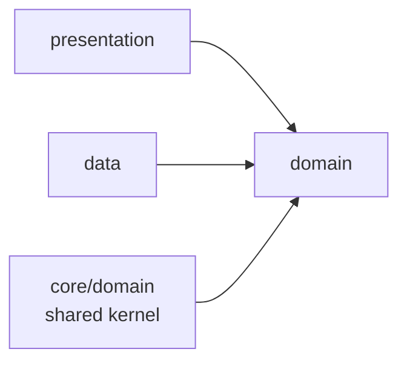

# Architecture

This is the map. It tells you what the layers are, where the shared types live,
which rules are enforced by a gate, and where to go next for the detail. It is
deliberately shallow: the places where an answer changes shape have their own
document, [`SEAMS.md`](SEAMS.md), and the decisions that produced them have
theirs in [`adr/`](adr/).

Every number below was measured against the tree on 2026-10-11 and carries a
`file:line` or a command you can re-run. Where a figure disagrees with
[`docs/agents/AGENT_CONTEXT.md`](agents/AGENT_CONTEXT.md), the code wins and
the disagreement is named. That authority document is nonetheless the single
source of truth for scope and standards — it outranks this file, and this file
outranks nothing.

## The one-paragraph version

Dependencies point inward and never outward. A `presentation` layer and a
`data` layer both depend on `domain`; `domain` depends on neither, and reaches
no framework at all. The types two or more features need live in one place,
`lib/core/domain/`, which is the shared kernel. Behind that kernel sit the
**five** repository ports, declared as abstract interfaces there and
implemented in each feature's `data/` layer. The single rule that makes the rest
of the structure hold is that **no feature may import another feature** — if two
features need the same type, it moves to `core/domain/` rather than one of them
importing the other.

The port count is five, not four. `lib/core/domain/repositories/` contains five
files, each declaring exactly one `abstract interface class`:
`auth_repository.dart:43`, `leaderboard_repository.dart:40`,
`reading_repository.dart:83`, `settings_repository.dart:61` and
`streak_repository.dart:43`. Five ports is correct here. ADR-0005 decided four
and then recorded, in its own "Neutral / noted" section, that the directory
would hold five once the leaderboard feature landed
([ADR-0005](adr/0005-four-narrow-ports-no-fat-repository.md)).
AGENT_CONTEXT §3 still names four in its SOLID table; treat that as a stale
restatement of a decision that was itself recorded correctly.

## Layers and what each may import

The whole shape of the codebase is one arrow. Everything else in this section
follows from it, and the arrow is enforced by a scan rather than by review.



Each row below is a directory you can point at. "Must never import" is the
column that is actually gated; the "may import" column is the direction that
makes the gate possible to write at all.

| Layer | Directory | May import | Must never import | Mechanically checked by |
| --- | --- | --- | --- | --- |
| presentation | `features/*/presentation/` | `domain`, `core/*` | `data`, other features | Gate 2 |
| domain | `features/*/domain/` | `core/domain`, `core/common` | Flutter, Dio, http, `data` | Gates 1 and 2 |
| data | `features/*/data/` | `core/domain`, `core/network` | other features | Gate 2 |
| shared kernel | `core/domain/` | `core/common` | Flutter, Dio, http | Gate 1 |
| composition root | `lib/app/` | everything | — | exempt from Gate 2 |

The exception in the last row is deliberate and small. Gate 2 exempts `lib/app/`
because it is the one place allowed to know about two features at once — the
sign-out listener in `navigation_injection.dart:313` holds both an `AuthBloc`
and a `HomeBloc`, and neither feature may import the other. The composition root
is where cross-feature wiring belongs, so it is the one directory where such
wiring is legal.

### What the purity gate matches, and why

`tool/verify_purity.sh` Gate 1 (line 173) scans nine directories for a single
pattern:

```text
^[[:space:]]*(import|export|part)[[:space:]]+'package:(flutter|dio|http)/
```

Two properties of that line are deliberate, and both were bought with a bug.

The pattern matches **`import`, `export` and `part`**, not just `import`. All
three directives make the named library part of the file's own surface, and an
`export 'package:flutter/material.dart';` satisfies no lint — nothing else in
the toolchain would catch it. That regression was found by negative control, not
by reading the code, and the script says so at line 159.

The pattern is **anchored to a directive keyword** rather than searching for the
substring `package:flutter`. An earlier version used a bare substring search and
had to be weakened, because this repository documents its own purity rule in
prose — and a doc comment explaining *why* a file is dependency-free names the
forbidden package by name. A substring scan would have forced that
documentation to be watered down to keep a gate green. Anchoring to the
directive means the explanation can stay accurate. The script records this at
line 164: "Do not 'simplify' it back."

## The shared kernel

`lib/core/domain/` holds every type two or more features consume. The test that
decides placement is short enough to hold in your head:

> Used by exactly one feature → that feature's `domain/`. Used by two or more →
> `core/domain/`. Nothing enters `core/domain/` speculatively.

The failure it prevents is concrete. Three features read the same backend
payload — `home`, `reading` and `quiz` all need to submit an answer — so all
three need `ReadingRepository`. If it lived in any one of them, the other two
would have to import across the feature boundary to reach it, which Gate 2
forbids and which would be the wrong dependency regardless. Declaring it once
in `core/domain/` is what lets three features share one implementation without
sharing a feature.

Verified contents: **39 `.dart` files** under `lib/core/domain/`, of which
**7** are ports, **1** is `usecase/usecase.dart`, and **31** are entities —
20 hand-written plus **11** generated `.freezed.dart` companions.

```tree
core/domain/
  entities/    20 hand-written files, 11 generated .freezed.dart companions
  repositories/ 7 files, 7 abstract interface classes
  usecase/     usecase.dart — UseCase<In, Out>, NoParamsUseCase<Out>
```

Two entries in this tree differ from AGENT_CONTEXT §3. That section lists
`AppThemeMode` inside `user_settings.dart`, but it is its own file at
`entities/app_theme_mode.dart:32`, and `UserRole` is a third entity file at
`entities/user_role.dart:97` that §3 does not list at all. The entity list has
grown past the table that describes it.

**Task 5.7 added three more, and they are the first ones that had to MOVE.**
`CurtainShape`, `SkyStarShape` and `SkyStarField` are enums the design system
draws with and `UserSettings` holds — and `UserSettings` is in
`core/domain/`, which **Gate 1 holds Flutter-free**. `SkyStarShape` and
`SkyStarField` were declared inside
`core/design_system/widgets/witness_sky.dart` until Task 5.7 and had to move
out, because a `core/domain/` entity cannot name a type declared beside a
Flutter widget. **They are imported by path, not re-exported through the
design-system barrel** — `barrel_test.dart` holds the barrel to re-exporting
nothing from a domain, and a re-export through a design-system file makes the
analyzer report that file's own imports as `unnecessary_import`, because the
barrel already provides the enums through that very file.

## The ports and their adapters

Five ports, five production adapters, and a set of test doubles. The rule that
makes them substitutable is stated once here and enforced in every module: an
adapter registers **against its port**, never against its concrete class, so no
bloc and no page ever names a concrete adapter.

| Port | Declared at | Production adapter | What it owns |
| --- | --- | --- | --- |
| `ReadingRepository` | `reading_repository.dart:83` | `DioReadingRepository` | today's reading, scripture, submit |
| `StreakRepository` | `streak_repository.dart:43` | `DioStreakRepository` | streak summary and today's status |
| `LeaderboardRepository` | `leaderboard_repository.dart:40` | `DioLeaderboardRepository` | the ranked board |
| `AuthRepository` | `auth_repository.dart:43` | `FakeAuthRepository` | the seeded session |
| `SettingsRepository` | `settings_repository.dart:61` | `SettingsRepositoryImpl` | local preferences |

Two entries in that table are worth a second look, because both look like
mistakes and neither is.

`AuthRepository`'s only adapter is named `FakeAuthRepository`, and it ships in
`lib/`, not `test/` — at
`lib/features/auth/data/repositories/fake_auth_repository.dart:69`. That is
correct. There is no auth endpoint on the backend at all (AGENT_CONTEXT §2,
decision 3); login is UI-only and the seeded session *is* the real behaviour.
A file named `Fake` that is the production implementation is the honest name
for it.

`LeaderboardRepository` has two adapters: the HTTP one and
`StubLeaderboardRepository`, selected by a `useStubLeaderboard` flag in
`leaderboard_module.dart:49`. So the "one adapter, delete the port" rule below
has already been applied and the port kept, correctly, because something does
substitute it.

### Why registration happens against the port

`injection.config.dart` shows the rule in every line that registers a
repository. Line 94 reads `gh.lazySingleton<_i499.ReadingRepository>` — the
abstract interface, imported from `core/domain/repositories/`. No registration
in the generated file names a concrete repository class.
`test/app/di/injection_test.dart:617` asserts that in the failing direction.

The practical consequence: substituting a different adapter is a one-line change
to one module getter. Nothing that consumes the port can notice, because nothing
that consumes the port can see the concrete type.

### Test adapters

Test doubles are per-test and local. There is no shared `test/fakes/` directory;
the doubles are declared where they are used, across the `test/support/`
harnesses and individual test files. `test/support/app_harness.dart` holds the
widest set, including `_FakeReadingRepository` at `:493` and
`_FakeStreakRepository` at `:532`; `AuthRepository`'s double is reused from
`lib/` directly.

### The rule for future ports

> If a new port ever ends up with a single adapter that nothing substitutes,
> delete it.

That is a rule about *future* ports, not a description of the current ones, and
it comes from `docs/plans/10-open-decisions.md` §16 as recorded in ADR-0005. Its
purpose is to stop an interface from accreting because the layering diagram
looked empty without it. The full argument, including why the pre-cut
`model → data source → repository impl → port` chain was rejected, is in
[ADR-0005](adr/0005-four-narrow-ports-no-fat-repository.md).

## The data path

One path, walked once end to end. Every turn in it is a place where the answer
to "what shape is this data?" changes.

```tree
TodayReadingPanel
  └─ Bloc ─┬─ LoadTodayReading (use case)
  │        └─ ReadingRepository   ← PORT, declared in core/domain
  │            └─ DioReadingRepository   ← ADAPTER, in features/*/data
  │                └─ ReadingRemoteDataSource  → Dio.get → Object?
  │                    └─ TodayReadingMapper   → Result<TodayReading>
  └─ HomeState (freezed) → rebuild
```

The path above is the one SEAMS.md draws, and the class names in it all check
out against the tree. There are five data sources in `lib/`, of which three are
remote (`leaderboard`, `reading`, `streak`) and two are local (`auth`,
`settings`), and four mappers, all under a feature's `data/mappers/`.

Three things about this path are not derivable from reading it, and each has
cost someone an afternoon.

**Mappers are hand-written and return `Result<T>`.** There is no
`json_serializable` anywhere in the project — decision 8c forbids adding it, and
`json_serializable` is named there by name. A mapper therefore owns two
obligations at once: it knows the wire shape, and it converts a decoding failure
into a typed `Failure` rather than an exception. Moving JSON knowledge out of
the mapper and into an entity would leak transport into the domain and fail
Gate 1.

**`text_clean` exists only in Arabic.** On an English response the key is
**absent, not null** — there is no such field in the body at all. The mapper
takes `text_clean` when present and falls back to `text` otherwise
(`today_reading_mapper.dart:370`). A mapper that read the key unconditionally
and defaulted a `null` to `""` would silently render empty verses on every
English reading.

**Backend ids are not reliably UUIDs, and today's one is.** Measured against a
live server on 2026-10-11: today's `reading_id` is the seeded `aaaaaaaa-…` UUID,
while any `?date=`-provisioned reading gets `reading-group-3-<date>`. So do not
validate them as UUIDs — a validator would be correct today and wrong tomorrow.
They are **echoed**, never authored. The full measurement is in
[`docs/BACKEND-VERIFICATION.md`](BACKEND-VERIFICATION.md), and the correction to
AGENT_CONTEXT §5's own stronger claim is recorded in DRIFT.md §4.

There is a fourth fact on this path that is a decision rather than a
measurement: two error body shapes. `{"error", "message"}` is the only one this
server emits; `{statusCode, code, error, message}` appears nowhere in it. The
mapper accepts both, and the test group for the second is deliberately named
`SYNTHETIC — defensive branch, a body this server cannot produce`
(`test/core/network/api_error_mapper_test.dart:228`), because a test that
asserts a response shape the backend cannot produce is a test written against a
fiction.

## Dependency injection, and why it is two files

The object graph is split across two files, and the split is not a preference.
`lib/app/di/injection.dart` must be Flutter-free not merely in its own imports
but in its whole transitive project-local import closure — a walk enforced by
`injection_test.dart`. That constraint is what splits the graph in two.

| Half | File | Registrations | Lifetime |
| --- | --- | --- | --- |
| Generated | `injection.config.dart` | **30** | all `@lazySingleton` |
| Hand-written | `navigation_injection.dart` | **10** | 7 singleton, 3 lazy |

The 30 are counted by the `gh.` registration calls in
`injection.config.dart:74-140`. The 10 are counted in
`navigation_injection.dart:245-258` and resolve into: six blocs and cubits plus
`SettingsHandle`, all `registerSingleton`, then `AuthStatus`,
`ReevaluateListenable` and `AppRouter`, all `registerLazySingleton`.

Why the ten are hand-written at all is spelled out in the file's own header
(`navigation_injection.dart:29-48`), and it is a three-step trap. `Bloc` and
`Cubit` arrive only through `package:flutter_bloc/flutter_bloc.dart`, which
re-exports Flutter's widget layer alongside the bloc. The obvious-looking
import — `package:bloc/bloc.dart` — is unavailable because `bloc` is a
transitive dependency and AGENT_CONTEXT §8.4 forbids promoting it. So there is
no spelling of "register this bloc" that keeps Flutter out of the closure.
`AppRouter` hits the identical wall through its generated `.gr.dart` files.

The cost of that is five registrations written by hand instead of generated,
and the file says so plainly at line 58 rather than leaving it to be
discovered. There are **8** `@module` files in `lib/app/di/modules/`, not six as
AGENT_CONTEXT states; `result_module.dart` is deliberately empty and emits no
registration, and the record of what the graph actually contains is the
committed `injection.config.dart`, not the file names.

### The lifetime rule, and why it is not taste

> `registerSingleton` for anything holding a stream. `lazySingleton` for the
> router.

A factory or lazy singleton whose construction re-ran would hand out a
*second* bloc with its own state. That sounds like a small problem until you
look at `QuizState.lastResult`: it is the only holder of the submit response,
because `features/result/` cannot import `QuizBloc` across the feature boundary.
A second `QuizBloc` would have a `null` `lastResult` for ever, and a reader who
answered three questions and pressed "See results" would land on `/result`,
which cannot be built without a graded answer. The failure is not a wrong score;
it is a screen that never appears, with nothing in the log.

`AppRouter` is the mirror-image case. A factory guarantees a second router with
its own `navigatorKey` and no `Navigator` behind it, and nothing about either
object looks wrong — which is why the file records the mutation that turns the
identity assertions red.

### Why `bootstrapApp`'s order is load-bearing

`bootstrap.dart:68` runs four steps, and the order is the entire content of the
function:

1. `WidgetsFlutterBinding.ensureInitialized()` — a platform channel with no
   binding under it throws, and the settings repository talks to one.
2. `installPackageDefaults()` — before DI, before the router, before any widget,
   because it rewrites `flutter_animate`'s mutable statics. Installed late it
   would be correct for every widget built afterwards and silently wrong for the
   first ones.
3. `await configureDependencies()` — the `await` is deliberate and is not to be
   "cleaned up". See below.
4. `configureNavigation()` — **after** DI, because `AppRouter`'s provider reads
   `AuthStatus` out of the locator as it constructs.
5. `run(const EvangelionApp())`.

The `await` deserves its own note because it looks like lint noise.
`configureDependencies()` is declared `Future<void>` while the generated
`getIt.init()` is still synchronous, so `await_only_futures` rejects awaiting it
and `unawaited_futures` is what rejects *dropping* it the day a module registers
an async dependency. The lint stays strict rather than being silenced with an
ignore, so the transition becomes a compile error a human has to resolve.

`run` is a parameter rather than a direct call so that steps 3–5 are executable
by a test. The previous arrangement had the ordering in `main()` and graded the
file as text, which a `main()` with an empty body — an app that launches to a
blank frame — left green.

## Routing

Navigation is `auto_route`, and `AppRouter` declares **8 entries**: seven
`AutoRoute`s (`/login`, `/`, `/reading`, `/quiz`, `/result`, `/settings`,
`/communion`, `/journey`) and a `RedirectRoute` for `*`, at `app_router.dart:244-272`.
`app_routes.dart` declares **9** route constants — the seven, plus `/servant`,
which is deliberately declared but not routed, plus the `*` fallback. Gate 4
verifies all nine are plain string literals, which is what makes the invariants
in `app_routes_test.dart` assert anything at all.

The wildcard must be listed **last**. `auto_route` matches in declaration order,
so a `*` at the front swallows every real route; moving it turns 46 tests red.

### The guard depends on a one-member interface, not a bloc

`AuthGuard` depends on `AuthStatus`, an `abstract interface class` with exactly
one member — `bool get isAuthenticated` (`auth_status.dart:41,95`). It does not
depend on `AuthBloc`, which did not exist when the guard was designed and which
would have made routing depend on a feature's presentation layer.

Four contracts follow, and each costs something when broken: `isAuthenticated`
must be a cheap pure read (the guard calls it on every navigation *and* every
stack re-evaluation); it must not throw, because the guard does not catch and a
throw on a cold launch is a blank first frame; the guard is a fresh instance per
route per read; and it latches inside `_redirectToLogin`, because completing a
`NavigationResolver` twice is an assertion error in debug — on every successful
sign-in.

**`AuthGuard` is explicitly not a security boundary.** There is no auth endpoint
on the backend; identity is three headers the client sets and nothing validates
them (`auth_status.dart:33-40`). The guard protects navigation flow and nothing
else, which is why failing closed *silently* would buy no security and would
cost diagnosability.

### `/result` is not deep-linkable, on purpose

`ResultRoute` takes its `result` as a required constructor parameter, so
`pushPath('/result')` cannot build the page. This is correct rather than
accidental: the submit response is the only artifact the screen renders and
there is nothing to re-fetch it from. `test/app/router/app_router_test.dart:442`
asserts the failure deliberately, in the failing direction, so the property
cannot rot silently.

### The router overrides `config()`

`AppRouter` overrides `config()` to append an `AutoRouteObserver`
(`app_router.dart:205`). This is not decoration.
`RootStackRouter`'s default is `const []`, and `AutoRouteAwareStateMixin`
guards on `if (_observer != null)` — so with the package default the entire
re-entry mechanism is a **silent no-op** and `/` never re-loads on return. It is
overridden rather than passed at the two call sites because, as the file records
it, "the whole defect was a default nobody overrode."

## Theme, locale and font scale

Eight token files, verified in `lib/core/design_system/tokens/`:
`eva_colors.dart`, `eva_elevations.dart`, `eva_motion.dart`, `eva_radii.dart`,
`eva_spacing.dart`, `eva_type_scale.dart`, `eva_typography.dart` and
`sticker_palette.dart`.

**The accent splits into a fill and an ink, and only the light values differ.**
One colour cannot do both jobs: as a fill it must stay light enough that
`onEmber` reads against it, and as text on a pale surface it must clear 4.5:1.
Light `ember` measures **2.11:1** and fails.

| token | dark | light | used for |
| --- | --- | --- | --- |
| `ember` | `#E8A33D` | `#D4891A` | fills: buttons, chips, beads, flame |
| `emberInk` | `#E8A33D` | `#845610` | text, drop caps, verse numbers |

Verified at `eva_colors.dart:71` and `:119` for `ember`, `:76` and `:126` for
`emberInk`. In dark the two are identical **on purpose** — the accent already
clears 6.97:1 there, so a second name would be a second way to change the same
thing.

The theme mode is **persisted and reader-controlled**, and this corrects a claim
in two other documents. SEAMS.md §7 says `app.dart` "sets `ThemeMode.dark`
explicitly and still does — any comment promising otherwise is stale." That is
no longer true. `app.dart:284` reads:

```dart
themeMode: switch (settings.themeMode) {
  AppThemeMode.light => ThemeMode.light,
  AppThemeMode.dark => ThemeMode.dark,
  AppThemeMode.system => ThemeMode.system,
},
```

It was a hard-coded `ThemeMode.dark` for eight phases; a reader can now change
it, and the exhaustive `switch` means a fourth `AppThemeMode` is a compile
error at the composition root rather than a screen that keeps the old palette.
The *default* is still `AppThemeMode.dark`, so a fresh install is unchanged —
which is why the old sentence and the new behaviour can both feel true, and why
you should read the code rather than the prose. Settings themselves remain
**local only** (`shared_preferences`, no server sync).

### Arabic typography answers two different questions

There are two mechanisms, keyed on different facts, and they are allowed to
disagree:

- **`arabicAware(style, direction)`** (`eva_typography.dart:246`) is the
  *ambient chrome arm*. It takes the engine's `TextDirection` and is for runs
  that render the app's own strings, where the ambient direction is the whole of
  what the caller knows. It is identity under LTR and a family swap under RTL.
  `Amiri` is the only bundled family that renders Arabic.
- **The per-arm `*FamilyFor` switches stay**, and they are keyed on the
  *payload's* arm — `TodayReading.language`, `ReadingLanguage` — which is a
  different fact and survives the two disagreeing.

`MaterialApp` has no per-locale theme hook, so there is nowhere to put a second
`TextTheme` the engine would choose between; that framework fact is why this is
a helper rather than a theme. `l10n.dart` adds a third, separate rule — a
numeral rule keyed on the locale, deliberately *not* `arabicAware`.

Four strings once reached `/` in a Latin-only face and every glyph rendered as
tofu. The gate that caught it checks the **rendered** tree, not the call site,
and is described in full in
[ADR-0010](adr/0010-arb-and-gen-l10n-replace-string-tables.md) and
`test/support/arabic_typography_gate.dart`.

## Project layout

Verified against the tree. Paths are real; the annotations are the part worth
reading.

```tree
lib/
  main.dart                        bootstrap entry
  app/                             composition root — the only cross-feature seam
    app.dart                       MaterialApp: theme, locale, mode
    bootstrap.dart                 4 ordered steps + installPackageDefaults
    settings_handle.dart           reader prefs as a read/write handle
    settings_scope.dart            inherits SettingsHandle down the tree
    di/
      injection.dart               @InjectableInit; stays Flutter-free
      injection.config.dart        GENERATED, committed — 30 registrations
      navigation_injection.dart    hand-written Flutter half — 10 regs
      modules/                     8 @module files (result is empty)
    router/
      app_router.dart              7 AutoRoutes + 1 RedirectRoute
      app_router.gr.dart           GENERATED
      auth_guard.dart              depends on AuthStatus, not AuthBloc
  core/
    common/                        Result<T>, Failure (12 kinds), AppConfig, ranges
    design_system/                 23 widgets, effects, motion, theme, tokens/
    domain/                        THE SHARED KERNEL — 30 files, pure Dart
      entities/                    15 hand-written + 9 generated .freezed.dart
      repositories/                5 ports, 5 abstract interface classes
      usecase/                     UseCase<In, Out>, NoParamsUseCase<Out>
    navigation/                    AppRoutes, AuthStatus, landing/role access
    network/                       Dio client, error mapper, interceptors/
  features/                        auth, home, leaderboard, quiz, reading,
                                   result, settings — 7 features
    <f>/domain/                    6 features have one; pure Dart, use cases only
    <f>/data/                      4 features have one: auth, leaderboard,
                                   reading, settings
    <f>/presentation/              bloc/cubit, pages, widgets
  l10n/                            ARB + generated AppLocalizations (111 keys)

tool/
  verify_all.sh                    gates 1-7 in cost order (+ --with-build)
  verify_purity.sh                 the 4 architecture gates
  feature_import_check.dart        Gate 2's per-file comparison
  route_check.dart                 Gate 4's declaration parsing
  verify_linux_build.sh            opt-in: proves the app really builds
  verify_gates_selftest.sh         plants violations to prove gates fire
  fix_named_fold.py                the one-off Result migration fixup
  gates/citation_check.py          every *.tsx:NNN claim resolves
  gates/orphan_widget_check.py     every design-system widget is reachable
  baseline/gates.txt               the recorded coverage/test floor

docs/
  ARCHITECTURE.md                  this file — the navigable map
  SEAMS.md                         the seven seams — read this for depth
  DRIFT.md                         claims that were checked and found wrong
  BACKEND-VERIFICATION.md          the measured backend contract
  adr/                             ADR-0001 … ADR-0010
  agents/AGENT_CONTEXT.md          the single source of truth (4134 lines)
  plans/                           the port plan, written before the cut
```

Four counts in that tree are worth stating as measurements rather than letting
a reader assume them, because the figures circulating in older documents are
wrong: **7** features and 7 screens (not six), **8** `@module` files (not six),
**23** design-system widgets (not 27), and **111** ARB keys in each of
`app_en.arb` and `app_ar.arb` (not 72).

## Where to read next

This file is the map; these are the destinations. Each one answers a different
question, and they overlap less than they appear to.

| Document | Read it for |
| --- | --- |
| [`SEAMS.md`](SEAMS.md) | The seven seams, in depth. Where the answer to a question changes shape. Start here when this file is not enough. |
| [`DRIFT.md`](DRIFT.md) | Claims that were checked against the code and found wrong. Read once before you contribute — most of them were true when written. |
| [`agents/AGENT_CONTEXT.md`](agents/AGENT_CONTEXT.md) | **The single source of truth.** Scope, locked decisions, the backend contract, Dart standards, the verification gates. It wins over this file and over every other document in the repository, including `AGENTS.md` and `CONTRIBUTING.md`. 4134 lines; read the section you need. |
| [`adr/`](adr/) | The decision record, ADR-0001 to ADR-0010. Each states the alternatives rejected and what the decision cost. ADR-0003 (layers), ADR-0004 (shared kernel), ADR-0005 (ports) and ADR-0006 (`Result`) cover this document's subject matter directly. |
| [`BACKEND-VERIFICATION.md`](BACKEND-VERIFICATION.md) | The measured backend contract — what the server actually returns, as opposed to what the plan assumed. |
| [`plans/`](plans/) | The original port plan, written before the Library and Profile screens were cut. Useful for intent; **do not edit it**, it has a dedicated owner. |

Two of these cross-reference each other usefully: SEAMS.md is the depth, and
this file is the navigation into it. Where the two disagree, both are checked
against the code, and the code wins.

## How this is enforced

Every rule above that can be checked mechanically has a gate, and every gate
lives in `tool/verify_all.sh` (gates 1–7) or `tool/verify_purity.sh` (the four
architecture gates). Run `tool/verify_all.sh` for the seven fast ones and
`--with-build` to add the eighth.

| # | Rule | Enforcing gate | A failure means |
| --- | --- | --- | --- |
| 1 | `lib`, `test`, `tool` are `dart format`-clean | `dart format --output=none --set-exit-if-changed` | Nothing else is meaningful until this passes. |
| 2 | Types, lints and deprecated APIs | `dart analyze --fatal-infos --fatal-warnings` | One command enforces all three. It is the real gate for the forbidden-API table, which is only a seed. |
| 3 | Purity, feature independence, generated files, route inventory | `tool/verify_purity.sh` | One of four named gates failed; each prints its own scope. |
| 4 | Prototype citations resolve; widgets are reachable | `tool/gates/citation_check.py`, `orphan_widget_check.py` | A `*.tsx:NNN` claim points at a line that changed, or a widget is built and tested but no page instantiates it. |
| 5 | No deprecated or lint-fixable API remains | `dart fix --dry-run` | **Read the output, not the exit code.** This command exits `0` even when it has work to do. |
| 6 | Behaviour unchanged | `flutter test` | A behaviour changed, or a test is flaky. Use `flutter test`, never `dart test` — the plain Dart VM has no `dart:ui`. |
| 7 | Coverage and test count meet the recorded floor | `flutter test --coverage` vs `tool/baseline/gates.txt` | Coverage or test count fell below a floor that is only ever written by `--update-baseline`, so one bad run cannot permanently lower the bar. |
| 8 | The app really builds | `tool/verify_linux_build.sh` (opt-in) | The toolchain is missing, not the source. A build reporting success is not evidence. |

### The three-outcome contract

Every gate in `verify_all.sh` reports one of three outcomes, and the third is
the entire point of the design.

| Outcome | Meaning | Exit |
| --- | --- | --- |
| `ok` | The gate ran and passed. | — |
| `FAIL` | The gate ran and found something. | `1` |
| `FATAL` | The gate **could not run** — a missing tool, a broken `rg`, an unreadable baseline. | `2` |

`FATAL` is not a flavour of `ok`. A gate that could not run is never a pass,
because it is indistinguishable from one and reading the exit code alone cannot
tell you which you got: `2` means nothing was checked.

The reasons are recorded, and they are not hypothetical. A ripgrep pattern using
a backreference fails to *compile*, exits `0`, and marks every line "passing" —
ripgrep has no backreferences. A script reading only stdout turns a missing
`rg` into empty output, a hit count of zero and a cheerful `PASSED`;
`verify_purity.sh:48` now probes that `rg` can match a known string before it
trusts it. And a check that runs *after* the step it audits can never observe
the condition it names — which is why gate 3 is about generated files and not
about whether the generator ran.

Every gate here is negative-controlled, and that is a property you can check
rather than a claim you have to trust. If you change a gate — or any input it
reads — **plant a violation and prove it fires before you report it fixed.** Put
it in a scratch copy outside the repository, confirm the correct non-zero exit
and the correct message, then remove it.
`tool/verify_gates_selftest.sh` does this for the existing gates if you want a
worked example rather than a description.

## What I measured, and what I could not

Recorded so the next reader can re-run it rather than trust it.

| Figure | Value | How it was obtained |
| --- | --- | --- |
| Repository ports | **5** | `rg 'abstract interface class' lib/core/domain/repositories/` |
| `@module` files | **8** | `ls lib/app/di/modules/` |
| DI registrations | **30 + 10** | `rg -c 'gh\.' injection.config.dart`; read `navigation_injection.dart:245-258` |
| Routes | **7 + 1 wildcard**, **9** constants | `app_router.dart:242-264`; Gate 4's own output |
| Features / screens | **7 / 7** | `ls lib/features/`; `find lib/features -name '*page.dart'` |
| Design-system widgets | **23** | `ls lib/core/design_system/widgets/*.dart \| wc -l` |
| ARB keys | **111** per locale | JSON parse of `app_en.arb` / `app_ar.arb`, excluding `@` metadata |
| `FailureKind` members | **12** | `rg` over the enum in `failure.dart` |
| Files in `core/domain/` | **30** (24 entities, 5 ports, 1 use case) | `find lib/core/domain -name '*.dart'` |
| Purity gates | all 4 pass | `tool/verify_purity.sh`, run live: 9 pure-Dart dirs, 9 owners, 2 generated files, 9 route declarations |

Stale claims found in the source documents, listed here rather than repeated:

- AGENT_CONTEXT §2 decision 1, "six screens" — there are **7**. Already
  recorded in DRIFT.md §1; §2 has not been updated.
- AGENT_CONTEXT §3, the shared-kernel tree — omits `today_reading.dart`,
  `leaderboard_board.dart`, `reading_language.dart`, `arabic_digits.dart`,
  `renderable_text.dart`, `drop_cap_text.dart` and `user_role.dart`; and places
  `AppThemeMode` inside `user_settings.dart` when it is its own file.
- AGENT_CONTEXT §3, the SOLID table's ISP row — "four narrow ports". Five files
  exist. ADR-0005 records this correctly; §3 does not.
- AGENT_CONTEXT §2.1 decision 8b — "72 ARB keys". **111** today.
- AGENTS.md:127 — "27 widgets" in the project-layout tree. **23** exist.
- ADR-0005 — `FakeReadingRepository` and `FakeStreakRepository` are described as
  hand-written for `bloc_test`. No such classes exist in `lib/`; the doubles
  are per-test, and `_FakeReadingRepository` / `_FakeStreakRepository` are
  private to `test/support/app_harness.dart`.
- SEAMS.md §7 — "`app.dart` sets `ThemeMode.dark` explicitly and still does".
  It does not; `app.dart:284` maps a persisted `settings.themeMode`.
- The brief for this document cited ADR-0015, ADR-0018 and ADR-0020. No ADR
  beyond 0010 exists; those numbers are not decision numbers either. The
  decisions they were meant to point at are recorded in AGENT_CONTEXT (the
  `/result` non-deep-link rule; the bilingual typography follow-up; the gate
  contract) and in SEAMS.md. No link to a nonexistent file was written.

Not verified, because it cannot be from this repository: everything about the
running server. The backend is a separate, read-only project; the figures here
come from `docs/BACKEND-VERIFICATION.md`, which measured a live process on
2026-10-11. If that document is stale, the id-shape and error-body claims above
are stale with it.
