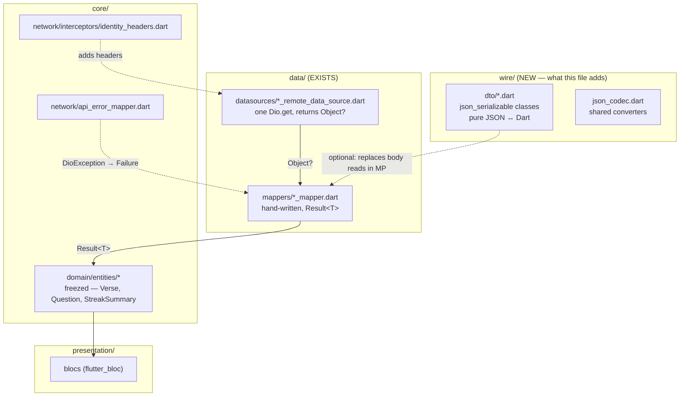

# API Models, Headers & Transport — `json_serializable` + `dio`

Companion to `docs/plans/05-domain-model.md`. This file covers the **wire layer**: the JSON shapes the
backend actually emits, the `json_serializable` classes that decode them, and how identity headers are
put on the wire.

Every JSON shape below was **captured from a live `app.inject()` run** against the backend, not read
out of a schema. Source citations are `EvangelionBackend/src/…`.

---

## 0. Read this first: two decisions already on record

Two things in this document contradict existing project decisions. Both are stated up front so
nobody has to discover them mid-task.

### 0.1 `json_serializable` is forbidden by `AGENT_CONTEXT` §2.1 decision 8c

> **8c** | **Do not add `bloc`, `json_serializable`, `flutter_svg` or `package:analyzer`** to do
> any of this.

`json_serializable` is not in `pubspec.yaml` today, and that is deliberate. Every existing data-layer
class is a **hand-written mapper returning `Result<T>`** — `leaderboard_mapper.dart` is 457 lines of
`Result`-returning reads, and its doc comment explains at length why keys are read as literals rather
than case-folded.

**So this file's models are a proposal, not a description of what is built.** If you adopt them you
must also amend decision 8c. See §7 for the tradeoff, and §6 for what breaks.

### 0.2 The headers are already solved, and solved well

`lib/core/network/interceptors/identity_headers.dart` is 166 lines that already answer "what headers,
why an interceptor, why the client validates the UUID". **§4 below explains the background; it does
not replace that file.** Nothing here needs changing to add headers.

---

## 1. Architecture: where these classes live



**DTOs are optional.** The existing mappers read `Object?` maps directly. A DTO layer is worth adding
only if you decide the hand-written key reads are too repetitive. §7 argues that trade explicitly.

---

## 2. What the backend actually sends

Fastify **strips** any response field not declared in a route's `response` schema. So the wire shape
is narrower than the service returns — DTOs must be written against the wire, not the service.

Verified: `/readings/today` bilingual sends `text_ar`/`text_en`; the *same route* with `?lang=ar`
sends a collapsed `text`. Two shapes, one URL.

### 2.1 Readings

```jsonc
// GET /api/v1/readings/today/ar          (and /en, and ?lang=ar|en)
{
  "reading_id": "aaaaaaaa-…", "group_id": 3, "scheduled_date": "2026-10-10",
  "language": "ar",
  "reference": "يوحنا 3: 1-5",          // string when localized, OBJECT when bilingual
  "translation": "Smith & Van Dyck (فانديك)",
  "verses": [ { "book_number":43, "chapter":3, "verse":1,
                "text": "…", "text_clean": "…" } ],   // text_clean ABSENT on /en
  "questions": [ { "id":"bbbb…", "sort_order":1, "type":"mcq",
                   "prompt": "…",                       // prompt_ar/prompt_en when bilingual
                   "options": { "A":"نِيقُودِيمُوسُ" },   // FLAT strings when localized
                   "points_value":10, "already_answered":false,
                   "user_answer": null, "is_correct": null } ],
  "is_fully_completed": false, "total_points_earned_today": 0, "current_streak": 4
}
```

```jsonc
// GET /api/v1/readings/today           (no ?lang — bilingual)
{
  "reading_id": "…", "group_id": 3, "scheduled_date": "…",
  "reference":   { "ar": "يوحنا 3: 1-5", "en": "John 3:1-5" },   // OBJECT
  "translation": { "ar": "…", "en": "…" },
  "verses":   [ { "book_number":43, "chapter":3, "verse":1,
                  "text_ar":"…", "text_ar_clean":"…", "text_en":"…" } ],
  "questions":[ { "id":"…", "sort_order":1, "type":"mcq",
                  "prompt_ar":"…", "prompt_en":"…",
                  "options": { "A": { "ar":"…", "en":"…" } },   // NESTED
                  "points_value":10, "already_answered":false,
                  "user_answer": null, "is_correct": null } ],
  "is_fully_completed": false, "total_points_earned_today": 0, "current_streak": 4
}
```

### 2.2 Passage lookup

```jsonc
// GET /api/v1/bible/verses/ar
{ "language":"ar", "book_number":43, "book_name":"يوحنا",
  "reference":"يوحنا 3: 1-3", "translation":"Smith & Van Dyck (فانديك)", "verse_count":3,
  "verses":[ { "chapter":3, "verse":1, "text":"…", "text_clean":"…" } ] }

// GET /api/v1/bible/verses/en   — same, minus text_clean
// GET /api/v1/bible/verses       — bilingual; NO language/book_name keys at all
{ "book_number":43,
  "reference":{ "ar":"…","en":"…" }, "translation":{ "ar":"…","en":"…" }, "verse_count":3,
  "verses":[ { "book_number":43,"chapter":3,"verse":1,
               "text_ar":"…","text_ar_clean":"…","text_en":"…" } ] }
```

Note `/bible/verses` emits **no `language` and no `book_name`** — its response schema doesn't declare
them (`readings.routes.ts:345-381`), so Fastify strips them.

### 2.3 Streak, leaderboard, submit

```jsonc
// GET /api/v1/streak          — summary + history (max 30 items)
{ "user_id":"…", "group_id":3, "current_streak":4, "longest_streak":6,
  "last_completed_date":"2026-09-29", "today_date":"2026-10-10",
  "today_scheduled":true, "today_completed":false, "today_status":"pending",
  "next_milestone":7, "days_to_milestone":3,
  "history":[ { "reading_id":"…","scheduled_date":"…","book_number":43,
               "book_name_ar":"يوحنا","book_name_en":"John",
               "reference":{ "ar":"…","en":"…" },
               "total_questions":1,"answered_questions":1,"correct_answers":1,
               "points_earned":10,"is_completed":true } ] }

// GET /api/v1/streak/summary — identical minus history
// GET /api/v1/leaderboard
{ "group_id":3, "window":"weekly", "total_ranked":0,
  "my_standing": { "rank": null, "score": 0 },        // null object, and null rank inside
  "leaderboard":[ { "userId":"…",        // ⚠️ camelCase
                   "score":50, "rank":1, "full_name":"David Mina (Grade 5)",
                   "current_streak":4 } ] }

// POST /api/v1/readings/{id}/submit  → 200
{ "question_id":"bbbb…", "is_correct":true, "points_earned":10,
  "current_total_points":60, "current_streak":5, "longest_streak":7,
  "reading_completed":true }
```

### 2.4 Errors — two shapes

```jsonc
{ "error": "Bad Request", "message": "headers must have required property 'x-group-id'" }
{ "error": "Validation Error", "details": { … } }     // zod failures only (admin/AI/submit)
{ "error": "Conflict", "message": "This question has already been submitted by this user." }
```

`ApiErrorMapper` already decodes these. No DTO needed — keep its path.

---

## 3. The `json_serializable` models

### 3.1 Setup — two steps you have not done yet

**a. Add the dependency.** `json_serializable` is a `dev_dependency` (it is a code generator), plus
`json_annotation` as a runtime dependency for the `@JsonKey` annotations:

```yaml
dependencies:
  json_annotation: ^4.9.0
dev_dependencies:
  json_serializable: ^6.9.0     # check `flutter pub outdated` before pinning
```

**b. Set the field-rename strategy.** This API is snake_case, so set it once globally rather than
annotating 60 fields:

```dart
// lib/wire/json_codec.dart

import 'package:json_annotation/json_annotation.dart';

/// Converts a wire `yyyy-MM-dd` string to a [DateTime?], for **nullable** fields.
///
/// The backend emits `scheduled_date` / `today_date` / `last_completed_date` as
/// `DATE` columns. Postgres renders them as `YYYY-MM-DD`, and `streak.service.ts:132-134`
/// normalises a `Date` row to the same string before JSON. So the wire type is a
/// *date*, not an instant — there is no time and no zone.
///
/// `DateTime.parse('2026-10-10')` returns a **local midnight**, which is correct for
/// a calendar day. Do not add `.toUtc()`: there is no UTC here to convert to, and it
/// would silently shift the day for anyone east of Greenwich.
DateTime? dateOnlyFromJson(Object? json) {
  if (json is! String) return null;
  return DateTime.tryParse(json);
}

/// Nullable counterpart. **Must** be nullable: json_serializable requires the
/// converter's return type to match the field's exactly.
String? dateOnlyToJson(DateTime? date) {
  if (date == null) return null;
  return '${date.year.toString().padLeft(4, '0')}-'
      '${date.month.toString().padLeft(2, '0')}-'
      '${date.day.toString().padLeft(2, '0')}';
}

/// The same pair for a **non-nullable** date field.
///
/// It cannot share [dateOnlyFromJson]: json_serializable rejects a converter
/// whose return type is `DateTime?` for a `DateTime` field. That strictness is
/// worth having — it stops a missing date from decoding to a silent midnight.
DateTime requiredDateOnlyFromJson(Object? json) {
  final DateTime? parsed = dateOnlyFromJson(json);
  if (parsed == null) {
    throw ArgumentError.value(json, 'json', 'expected a YYYY-MM-DD date string');
  }
  return parsed;
}

String requiredDateOnlyToJson(DateTime date) => dateOnlyToJson(date)!;

/// Shared annotation arguments.
///
/// Note the **string** keys: `fieldRename` is a `String` in the `JsonSerializable`
/// annotation, so `FieldRename.snake` unprefixed is not valid Dart here.
///
/// Applied as `@JsonSerializable()` **plus** these entries, or copied onto each
/// class. There is no `@JsonSerializable` parameter that reads a named constant,
/// so in practice: put `fieldRename: FieldRename.snake` on every class.
const Map<String, dynamic> wireJsonDefaults = <String, dynamic>{
  'fieldRename': FieldRename.snake,
  // Turns a backend rename into a loud failure at the seam instead of a field
  // quietly reading `null` and rendering "—".
  //
  // Verified: with this on, a renamed key throws `UnrecognizedKeysException`
  // naming the supported key set. Without it, the field is silently null.
  //
  // NOTE: this inverts the hand-written mappers' deliberate position
  // (leaderboard_mapper.dart:18-21 — "a case-folding reader would hide a future
  // rename instead of failing on it"). See §7.
  'disallowUnrecognizedKeys': true,
};
```

> **`disallowUnrecognizedKeys` is opt-in per class**, not a default this map can
> switch on for you — `wireJsonDefaults` is illustrative. Add it to each
> `@JsonSerializable(...)` you want strict. Note also that it throws
> `UnrecognizedKeysException`, **not** `CheckedFromJsonException` (verified).
>
> **Consider dropping it.** The project's stated position is the opposite (§7). It is
> included because for *this* API the risk is asymmetric: a silently-null field becomes a
> blank screen label with no error. Flip it if the team prefers tolerance.

### 3.2 Reading DTOs

```dart
// lib/wire/dto/reading_dto.dart
import 'package:json_annotation/json_annotation.dart';
import '../json_codec.dart';

part 'reading_dto.g.dart';

/// `{"ar": "…", "en": "…"}` — the bilingual form of `reference` and `translation`.
///
/// A separate class rather than `Map<String, String>`: the map would accept
/// `{"fr": "…"}` just as happily and decode a typo into an empty string.
@JsonSerializable()
class LocalizedTextDto {
  const LocalizedTextDto({required this.ar, required this.en});

  factory LocalizedTextDto.fromJson(Map<String, dynamic> json) =>
      _$LocalizedTextDtoFromJson(json);

  final String ar;
  final String en;
}

/// One verse from `/readings/today/{lang}`.
///
/// [textClean] is nullable **and** absent for English. That is not a defect: the
/// server only ever emits `text_clean` on the Arabic projection
/// (`readings.service.ts:251`). It is the diacritics-stripped search string —
/// see `scripture_verse.dart`, which already records that the sanctuary renders
/// `text` and uses `textClean` only for previews.
@JsonSerializable(fieldRename: FieldRename.snake)
class LocalizedVerseDto {
  const LocalizedVerseDto({
    required this.bookNumber,
    required this.chapter,
    required this.verse,
    required this.text,
    this.textClean,
  });

  factory LocalizedVerseDto.fromJson(Map<String, dynamic> json) =>
      _$LocalizedVerseDtoFromJson(json);

  final int bookNumber;
  final int chapter;

  /// Named `verse` because the wire key is `verse`. `json_serializable` has no
  /// shadowing hazard here — unlike the hand-written `Verse` entity, where the
  /// member had to be renamed to `number` to avoid shadowing its own constructor
  /// parameter. Keep them distinct so the mapper's rename stays visible.
  final int verse;

  final String text;
  final String? textClean;
}

/// One verse from `/readings/today` (bilingual) or `/bible/verses`.
///
/// All three text fields are always present on the bilingual wire shape — verified
/// live. There is no `?lang` projection for this endpoint, so nothing here is
/// nullable.
@JsonSerializable(fieldRename: FieldRename.snake)
class BilingualVerseDto {
  const BilingualVerseDto({
    required this.bookNumber,
    required this.chapter,
    required this.verse,
    required this.textAr,
    required this.textArClean,
    required this.textEn,
  });

  factory BilingualVerseDto.fromJson(Map<String, dynamic> json) =>
      _$BilingualVerseDtoFromJson(json);

  final int bookNumber;
  final int chapter;
  final int verse;

  /// Vocalised (tashkīl intact). This is what the sanctuary renders.
  final String textAr;

  /// Diacritics stripped. **Search and preview only** — never the rendered verse.
  final String textArClean;

  final String textEn;
}

/// One question, localized (`/readings/today/{lang}`).
///
/// [options] is `Map<String, String>` **only** here. On the bilingual route the
/// same JSON key holds `Map<String, {ar, en}>` — see [BilingualQuestionDto].
/// Two classes rather than one with a dynamic map, because the alternative is a
/// union type and a cast at every call site.
@JsonSerializable(fieldRename: FieldRename.snake)
class LocalizedQuestionDto {
  const LocalizedQuestionDto({
    required this.id,
    required this.sortOrder,
    required this.type,
    required this.prompt,
    required this.options,
    required this.pointsValue,
    required this.alreadyAnswered,
    this.userAnswer,
    this.isCorrect,
  });

  factory LocalizedQuestionDto.fromJson(Map<String, dynamic> json) =>
      _$LocalizedQuestionDtoFromJson(json);

  final String id;
  final int sortOrder;

  /// `'mcq' | 'true_false' | 'short_answer'` — a `String`, matching
  /// `question.dart`'s recorded scope decision. An enum here would need an
  /// `unknownValue` fallback anyway, because the server may add a member.
  final String type;

  final String prompt;

  /// Flattened to a single language by `formatLocalizedReading`.
  final Map<String, String> options;
  final int pointsValue;
  final bool alreadyAnswered;

  /// Null until answered — this is what makes a partially-finished quiz
  /// re-renderable after a restart.
  final String? userAnswer;
  final bool? isCorrect;
}

/// One question, bilingual (`/readings/today` with no `?lang`).
@JsonSerializable(fieldRename: FieldRename.snake)
class BilingualQuestionDto {
  const BilingualQuestionDto({
    required this.id,
    required this.sortOrder,
    required this.type,
    required this.promptAr,
    required this.promptEn,
    required this.options,
    required this.pointsValue,
    required this.alreadyAnswered,
    this.userAnswer,
    this.isCorrect,
  });

  factory BilingualQuestionDto.fromJson(Map<String, dynamic> json) =>
      _$BilingualQuestionDtoFromJson(json);

  final String id;
  final int sortOrder;
  final String type;
  final String promptAr;
  final String promptEn;

  /// `{"A": {"ar": "…", "en": "…"}}` — nested, unlike [LocalizedQuestionDto].
  final Map<String, LocalizedTextDto> options;
  final int pointsValue;
  final bool alreadyAnswered;
  final String? userAnswer;
  final bool? isCorrect;
}

/// `GET /readings/today/ar`, `/en`, and `?lang=` — the localized projection.
///
/// [language] arrives as `'ar'`/`'en'` and is worth carrying: it tells the mapper
/// which projection this actually is, and `formatLocalizedReading` is the only
/// place that knows.
@JsonSerializable(fieldRename: FieldRename.snake)
class LocalizedReadingDto {
  const LocalizedReadingDto({
    required this.readingId,
    required this.groupId,
    required this.scheduledDate,
    required this.language,
    required this.reference,
    required this.translation,
    required this.verses,
    required this.questions,
    required this.isFullyCompleted,
    required this.totalPointsEarnedToday,
    required this.currentStreak,
  });

  factory LocalizedReadingDto.fromJson(Map<String, dynamic> json) =>
      _$LocalizedReadingDtoFromJson(json);

  final String readingId;
  final int groupId;

  @JsonKey(
    fromJson: requiredDateOnlyFromJson,
    toJson: requiredDateOnlyToJson,
  )
  final DateTime scheduledDate;

  /// `'ar'` or `'en'`.
  final String language;

  /// Display string, **not** a parseable reference. The Arabic form has a space
  /// after the colon (`"يوحنا 3: 1-5"`) and the English form does not
  /// (`"John 3:1-5"`). `scripture_verse.dart` already records parsing this as a
  /// rejected idea — `bookNumber` is the server's own answer. Carry it; don't split it.
  final String reference;

  final String translation;
  final List<LocalizedVerseDto> verses;
  final List<LocalizedQuestionDto> questions;
  final bool isFullyCompleted;
  final int totalPointsEarnedToday;
  final int currentStreak;
}

/// `GET /readings/today` with **no** `?lang` — the bilingual projection.
///
/// Distinct from [LocalizedReadingDto] on three fields, all of them structural:
/// `reference`/`translation` are objects, and `verses`/`questions` are different
/// element types. It is a separate class because a single DTO with nullable
/// bilingual fields would need `!` at every use site.
@JsonSerializable(fieldRename: FieldRename.snake)
class BilingualReadingDto {
  const BilingualReadingDto({
    required this.readingId,
    required this.groupId,
    required this.scheduledDate,
    required this.reference,
    required this.translation,
    required this.verses,
    required this.questions,
    required this.isFullyCompleted,
    required this.totalPointsEarnedToday,
    required this.currentStreak,
  });

  factory BilingualReadingDto.fromJson(Map<String, dynamic> json) =>
      _$BilingualReadingDtoFromJson(json);

  final String readingId;
  final int groupId;

  @JsonKey(
    fromJson: requiredDateOnlyFromJson,
    toJson: requiredDateOnlyToJson,
  )
  final DateTime scheduledDate;

  final LocalizedTextDto reference;
  final LocalizedTextDto translation;
  final List<BilingualVerseDto> verses;
  final List<BilingualQuestionDto> questions;
  final bool isFullyCompleted;
  final int totalPointsEarnedToday;
  final int currentStreak;
}
```

### 3.3 Passage DTOs

```dart
// lib/wire/dto/passage_dto.dart
import 'package:json_annotation/json_annotation.dart';
import 'reading_dto.dart';   // LocalizedTextDto, BilingualVerseDto

part 'passage_dto.g.dart';

/// One verse from `/bible/verses/ar` and `/bible/verses/en`.
///
/// ## WHY THIS IS NOT `LocalizedVerseDto` — A BUG THE GENERATOR CAUGHT
///
/// These routes emit `{chapter, verse, text, text_clean}` with **no `book_number`** —
/// the book is named once at the top level as `book_name`, whereas
/// `/readings/today` repeats `book_number` on every verse. Reusing
/// `LocalizedVerseDto` here compiles perfectly and then throws at runtime:
///
/// ```
/// type 'Null' is not a subtype of type 'num' in type cast
///   at _$LocalizedVerseDtoFromJson (reading_dto.g.dart:17)
/// ```
///
/// That is `json_serializable`'s real value in this codebase: the key-set
/// mismatch is caught by a test that decodes a recorded payload, which is exactly
/// the class of error a hand-written mapper hides until a screen renders blank.
/// This was reproduced during the writing of this document.
///
/// [textClean] is absent on the English route, hence nullable.
@JsonSerializable(fieldRename: FieldRename.snake)
class PassageVerseDto {
  const PassageVerseDto({
    required this.chapter,
    required this.verse,
    required this.text,
    this.textClean,
  });

  factory PassageVerseDto.fromJson(Map<String, dynamic> json) =>
      _$PassageVerseDtoFromJson(json);

  final int chapter;
  final int verse;
  final String text;
  final String? textClean;
}

/// `GET /bible/verses/ar` and `/bible/verses/en`.
///
/// One class for both languages: they differ only in whether `text_clean` is
/// emitted, and a nullable field models that exactly. Separate classes would
/// duplicate six identical fields to express an absence.
///
/// Note these carry `bookName`/`bookNumber` at the top level, while the reading
/// DTOs carry `groupId` and put `bookNumber` on each verse. Different shapes for
/// the same scripture — the mapper, not the DTO, unifies them.
@JsonSerializable(fieldRename: FieldRename.snake)
class PassageDto {
  const PassageDto({
    required this.language,
    required this.bookNumber,
    required this.bookName,
    required this.reference,
    required this.translation,
    required this.verseCount,
    required this.verses,
  });

  factory PassageDto.fromJson(Map<String, dynamic> json) =>
      _$PassageDtoFromJson(json);

  final String language;
  final int bookNumber;
  final String bookName;
  final String reference;
  final String translation;

  /// Always equals `verses.length`. Kept because the server sends it; use
  /// `verses.length` for anything the UI shows.
  final int verseCount;

  /// [PassageVerseDto], **not** `LocalizedVerseDto` — see that class's note.
  final List<PassageVerseDto> verses;
}

/// `GET /bible/verses` — bilingual.
///
/// Emits **no `language` and no `book_name`**: its response schema
/// (`readings.routes.ts:345-381`) declares neither, so Fastify strips both.
@JsonSerializable(fieldRename: FieldRename.snake)
class BilingualPassageDto {
  const BilingualPassageDto({
    required this.bookNumber,
    required this.reference,
    required this.translation,
    required this.verseCount,
    required this.verses,
  });

  factory BilingualPassageDto.fromJson(Map<String, dynamic> json) =>
      _$BilingualPassageDtoFromJson(json);

  final int bookNumber;
  final LocalizedTextDto reference;
  final LocalizedTextDto translation;
  final int verseCount;
  final List<BilingualVerseDto> verses;
}
```

> `BilingualPassageDto.verses` reuses `BilingualVerseDto`, which declares `bookNumber`. That is
> correct — this route *does* emit `book_number` per verse, verified live. No field is missing.

### 3.4 Streak DTOs

```dart
// lib/wire/dto/streak_dto.dart
import 'package:json_annotation/json_annotation.dart';
import 'reading_dto.dart';
import '../json_codec.dart';

part 'streak_dto.g.dart';

/// `GET /api/v1/streak/summary`.
///
/// [todayStatus] is a closed 4-value set (`streak.service.ts:3`): `completed`,
/// `pending`, `off_day`, `broken`. Kept a `String` here and promoted to an enum in
/// the domain — `streak_summary.dart` is where that decision belongs, and a DTO
/// enum would force an `unknownValue` fallback on a set that cannot grow without
/// a backend change worth noticing anyway.
@JsonSerializable(fieldRename: FieldRename.snake)
class StreakSummaryDto {
  const StreakSummaryDto({
    required this.userId,
    required this.groupId,
    required this.currentStreak,
    required this.longestStreak,
    required this.lastCompletedDate,
    required this.todayStatus,
    required this.todayCompleted,
    required this.todayScheduled,
    required this.nextMilestone,
    required this.daysToMilestone,
  });

  factory StreakSummaryDto.fromJson(Map<String, dynamic> json) =>
      _$StreakSummaryDtoFromJson(json);

  final String userId;
  final int groupId;
  final int currentStreak;
  final int longestStreak;

  /// Nullable — a child who has never completed a reading has none. Not the same
  /// as a sentinel date; do not substitute one.
  @JsonKey(fromJson: dateOnlyFromJson, toJson: dateOnlyToJson)
  final DateTime? lastCompletedDate;

  final String todayStatus;
  final bool todayCompleted;
  final bool todayScheduled;
  final int nextMilestone;
  final int daysToMilestone;
}

/// One entry of `GET /api/v1/streak`'s `history` array.
@JsonSerializable(fieldRename: FieldRename.snake)
class StreakHistoryItemDto {
  const StreakHistoryItemDto({
    required this.readingId,
    required this.scheduledDate,
    required this.bookNumber,
    required this.bookNameAr,
    required this.bookNameEn,
    required this.reference,
    required this.totalQuestions,
    required this.answeredQuestions,
    required this.correctAnswers,
    required this.pointsEarned,
    required this.isCompleted,
  });

  factory StreakHistoryItemDto.fromJson(Map<String, dynamic> json) =>
      _$StreakHistoryItemDtoFromJson(json);

  final String readingId;

  @JsonKey(
    fromJson: requiredDateOnlyFromJson,
    toJson: requiredDateOnlyToJson,
  )
  final DateTime scheduledDate;

  final int bookNumber;
  final String bookNameAr;
  final String bookNameEn;
  final LocalizedTextDto reference;
  final int totalQuestions;
  final int answeredQuestions;
  final int correctAnswers;
  final int pointsEarned;
  final bool isCompleted;
}

/// `GET /api/v1/streak` — the summary plus history.
///
/// **Cost:** the backend issues ~64 queries for this response (30 history items ×
/// 2 queries each — `streak.service.ts:100-118`). Prefer [StreakSummaryDto] for
/// headers and widgets; fetch the full shape only for a history screen.
@JsonSerializable(fieldRename: FieldRename.snake)
class StreakDetailDto {
  const StreakDetailDto({
    required this.userId,
    required this.groupId,
    required this.currentStreak,
    required this.longestStreak,
    required this.lastCompletedDate,
    required this.todayDate,
    required this.todayScheduled,
    required this.todayCompleted,
    required this.todayStatus,
    required this.nextMilestone,
    required this.daysToMilestone,
    required this.history,
  });

  factory StreakDetailDto.fromJson(Map<String, dynamic> json) =>
      _$StreakDetailDtoFromJson(json);

  final String userId;
  final int groupId;
  final int currentStreak;
  final int longestStreak;

  @JsonKey(fromJson: dateOnlyFromJson, toJson: dateOnlyToJson)
  final DateTime? lastCompletedDate;

  @JsonKey(
    fromJson: requiredDateOnlyFromJson,
    toJson: requiredDateOnlyToJson,
  )
  final DateTime todayDate;

  final bool todayScheduled;
  final bool todayCompleted;
  final String todayStatus;
  final int nextMilestone;
  final int daysToMilestone;

  /// Capped at **30** by `LIMIT 30` (`streak.service.ts:94`).
  final List<StreakHistoryItemDto> history;
}
```

### 3.5 Submit DTOs

```dart
// lib/wire/dto/submission_dto.dart
import 'package:json_annotation/json_annotation.dart';

part 'submission_dto.g.dart';

/// Request body of `POST /api/v1/readings/{id}/submit`.
///
/// The reading UUID is the **path** segment, not a body field, so it is a
/// constructor parameter of the data source rather than a DTO member.
@JsonSerializable(fieldRename: FieldRename.snake)
class SubmitAnswerRequestDto {
  const SubmitAnswerRequestDto({required this.questionId, required this.answer});

  factory SubmitAnswerRequestDto.fromJson(Map<String, dynamic> json) =>
      _$SubmitAnswerRequestDtoFromJson(json);

  Map<String, dynamic> toJson() => _$SubmitAnswerRequestDtoToJson(this);

  /// **Must be a UUID or the server answers 400**
  /// `body/question_id must match format "uuid"` — verified live. AJV rejects it
  /// before the handler runs.
  ///
  /// Do **not** add a client-side UUID check to the mapper. `question.dart`
  /// already records why: the in-memory backend fabricates non-UUID ids
  /// (`question-group-3`) for any group but 3, so a client-side check would
  /// reject readings the server is happy to serve.
  final String questionId;

  /// `'A'`…`'D'` for `mcq`, `'A'`/`'B'` for `true_false`. Compared
  /// case-insensitively after trimming server-side
  /// (`submissions.service.ts:57-58`), so `'a'` and `' A '` both score.
  final String answer;
}

/// Response of the same call.
@JsonSerializable(fieldRename: FieldRename.snake)
class SubmitAnswerResponseDto {
  const SubmitAnswerResponseDto({
    required this.questionId,
    required this.isCorrect,
    required this.pointsEarned,
    required this.currentTotalPoints,
    required this.currentStreak,
    required this.longestStreak,
    required this.readingCompleted,
  });

  factory SubmitAnswerResponseDto.fromJson(Map<String, dynamic> json) =>
      _$SubmitAnswerResponseDtoFromJson(json);

  final String questionId;
  final bool isCorrect;

  /// 0 for a wrong answer. The server awards `points_value` (default 10) only
  /// when correct.
  final int pointsEarned;

  final int currentTotalPoints;

  /// Only recomputed when [readingCompleted] — otherwise these echo the user's
  /// stored values, they are not the answer to "what is my streak now".
  final int currentStreak;
  final int longestStreak;

  /// The last question of the reading flips this. Streaks advance **only** here.
  final bool readingCompleted;
}
```

### 3.6 Leaderboard DTOs

```dart
// lib/wire/dto/leaderboard_dto.dart
import 'package:json_annotation/json_annotation.dart';

part 'leaderboard_dto.g.dart';

/// One ranked row.
///
/// [userId] is the **only camelCase key in the entire API** — `full_name` and
/// `current_streak` in the same object are snake_case. Verified live. That is the
/// server's shape, not a typo to smooth over, so it gets an explicit `@JsonKey`
/// that overrides `FieldRename.snake`.
@JsonSerializable(fieldRename: FieldRename.snake)
class LeaderboardEntryDto {
  const LeaderboardEntryDto({
    required this.userId,
    required this.score,
    required this.rank,
    required this.fullName,
    required this.currentStreak,
  });

  factory LeaderboardEntryDto.fromJson(Map<String, dynamic> json) =>
      _$LeaderboardEntryDtoFromJson(json);

  @JsonKey(name: 'userId')
  final String userId;

  final int score;

  /// 1-based (`leaderboard.service.ts:65`).
  final int rank;

  final String fullName;
  final int currentStreak;
}

/// The caller's own position, or `null` when they are not on the board.
@JsonSerializable(fieldRename: FieldRename.snake)
class MyStandingDto {
  const MyStandingDto({required this.rank, required this.score});

  factory MyStandingDto.fromJson(Map<String, dynamic> json) =>
      _$MyStandingDtoFromJson(json);

  /// Null means **"no position"**, not 0th place. The server sends the key
  /// explicitly with a null value, which is distinct from the key being absent —
  /// `leaderboard_mapper.dart:383-416` draws exactly this distinction and
  /// `LeaderboardStanding` exists because of it.
  final int? rank;

  final int score;
}

/// `GET /api/v1/leaderboard`.
@JsonSerializable(fieldRename: FieldRename.snake)
class LeaderboardDto {
  const LeaderboardDto({
    required this.groupId,
    required this.window,
    required this.totalRanked,
    required this.myStanding,
    required this.leaderboard,
  });

  factory LeaderboardDto.fromJson(Map<String, dynamic> json) =>
      _$LeaderboardDtoFromJson(json);

  final int groupId;

  /// `'weekly' | 'monthly' | 'all_time'`. An invalid value is rejected by the
  /// server's schema with **400**, so this never sees a fourth member.
  final String window;

  /// ⚠️ **Rows returned, not cohort size.** The route sends
  /// `enrichedEntries.length` (`leaderboard.routes.ts:119`), so a cohort of 60
  /// with `limit=50` answers `50`. `cohortSizeOf` in `leaderboard_mapper.dart:172`
  /// already handles this — do not read this field as a denominator.
  final int totalRanked;

  final MyStandingDto? myStanding;
  final List<LeaderboardEntryDto> leaderboard;
}
```

### 3.7 Generate

```bash
dart run build_runner build --delete-conflicting-outputs
```

---

## 4. Headers — the full explanation

### 4.1 What the backend expects

Three headers, no authentication. `identity.middleware.ts:22-34` reads them and assigns
`request.user`. **That is all it does.**

| Header | Required by | Format | Enforced? |
| --- | --- | --- | --- |
| `X-User-Id` | most routes | any string | **presence only** |
| `X-Group-Id` | readings, leaderboard | integer 1–7 | **presence only** |
| `X-User-Role` | nothing | `kid`/`viewer_servant`/`admin_servant` | **parsed, never checked** |

Measured against the live backend (`identity_headers.dart:33-39` records this too):

| `X-User-Id` sent | Response |
| --- | --- |
| absent | **400** `headers must have required property 'x-user-id'` |
| empty | **401** `Missing user identification` |
| `not-a-uuid` | **200**, echoed back verbatim |

The backend performs **zero format validation**. That is the single most important fact about the
wire: *you* are responsible for the UUID shape, which is why `buildApiDio` throws `ArgumentError`
on a malformed one.

### 4.2 Why headers and not a token

**Usually** a real API uses `Authorization: Bearer <jwt>` — a signed, expiring credential the server
verifies. This backend has no `/login`, no `/me`, no token, and no signature check. Adding a bearer
token would mean minting a string the server never inspects: security theatre that reads as security.

So the honest model is: **`X-User-Id` is an assertion, not a credential.** Any client can claim any
UUID. That's a property of the backend, not something the client can fix.

What that means for your code:

- **Never treat `X-User-Role` as authorization.** It is advisory UX at best — it stops a child
  landing on a scheduling screen that makes no sense for them, and stops nothing else. There are zero
  role guards and zero 403s in the backend (`rg '403' src/` → no matches).
- **Don't add a "403 handling" path.** It cannot fire. Every endpoint is callable by anyone who sends
  a user id.
- **Expect no session expiry.** `AuthSession` correctly has no token and no expiry; that stays true.

### 4.3 How to send them with `dio`

**An interceptor, never a per-call argument.** `identity_headers.dart:20-28` gives the reason: a
forgotten `X-Group-Id` is a **400**, indistinguishable from a malformed body. Four repositories need
these headers, and none should be able to forget one — only expressible if no call site gets the
choice.

`IdentityHeadersInterceptor` already exists and is already wired into `buildApiDio` (`dio_client.dart:86`).
**You do not need to write any of this.** It overwrites rather than merges (`identity_headers.dart:138`),
so a call site cannot smuggle in a different identity.

If you need to add a header later — an `Accept-Language`, say:

```dart
final class AcceptLanguageInterceptor extends Interceptor {
  AcceptLanguageInterceptor(this._locale);

  final String _locale;

  @override
  void onRequest(RequestOptions options, RequestInterceptorHandler handler) {
    options.headers['Accept-Language'] = _locale;
    handler.next(options);
  }
}
```

Register it in `buildApiDio`'s single interceptor list (`dio_client.dart:86`) — the doc comment at
`:43-47` states the rule explicitly: **one list, one order, stated.** Do not add interceptors at the
call site.

### 4.4 Adding a real token later, without a rewrite

If the backend ever gains `/auth`, the change is confined to one class:

```dart
// Only when a real endpoint exists. Not before.
final class AuthTokenInterceptor extends Interceptor {
  AuthTokenInterceptor(this._token);

  final Future<String?> Function() _token;

  @override
  Future<void> onRequest(
    RequestOptions options,
    RequestInterceptorHandler handler,
  ) async {
    final String? token = await _token();
    if (token != null) options.headers['Authorization'] = 'Bearer $token';
    handler.next(options);
  }
}
```

`AuthSession` is already documented as "real as an interface, fake as an implementation", and its doc
(`auth_session.dart:23-26`) records that a real repository would leave `domain` and `presentation`
unchanged. The header interceptor is the same story. **Today, adding this would be inventing a
credential the server does not verify.**

### 4.5 Content-Type

`dio_client.dart:84` already sets `contentType: Headers.jsonContentType`. This matters: a `POST`
without it is a **415**, which is a status no one debugged until it happened.

---

## 5. Where DTOs meet dio

Data sources currently return `Object?` and hand it to a mapper. With DTOs, the decode happens at
the data source:

```dart
final class ReadingRemoteDataSource {
  const ReadingRemoteDataSource(this._dio);

  final Dio _dio;

  /// Decodes the response, or throws a [DioException] the repository converts.
  ///
  /// json_serializable throws `CheckedFromJsonException` — **not** a `DioException` —
  /// so a shape change escapes the seam and lands in the bloc as a crash. Either
  /// catch it here and rethrow as something `ApiErrorMapper` understands, or keep
  /// the mapper's `Result` as the safety net. See §7.
  Future<LocalizedReadingDto> today(ReadingLanguage language) async {
    final Response<Map<String, dynamic>> response =
        await _dio.get<Map<String, dynamic>>(
      TodayReadingMapper.pathFor(language),
    );
    return LocalizedReadingDto.fromJson(response.data!);
  }
}
```

**Keep the path in the mapper.** `leaderboard_mapper.dart:42-47` and `dio_client.dart:34-41` both
record the same rule: `/api/v1` belongs to the endpoint definition, not to `baseUrl`, so a deployment
behind a path-prefixed proxy stays reachable.

---

## 6. What adopting this breaks

Honest inventory, so the decision is made with open eyes.

| # | Impact | Severity |
| --- | --- | --- |
| 1 | **Violates `AGENT_CONTEXT` §2.1 decision 8c.** Must be amended first. | process |
| 2 | **Duplicates the hand-written mappers.** ~14 DTOs that read keys the mappers already read. | high |
| 3 | **Two error conventions at once.** Mappers return `Result.failure` with a human message naming the offending key; json_serializable throws with a field path. | high |
| 4 | **879 assertions name `Result`/`Failure`** (`AGENT_CONTEXT` §2.1). Mixing conventions splits the codebase. | high |
| 5 | **Adds 2 dependencies** (`json_annotation`, `json_serializable`) and a generated `build.yaml` entry. | low |
| 6 | **`disallowUnrecognizedKeys` inverts the project's stated position** (`leaderboard_mapper.dart:18-21`). | low |

### The case *for*

- 60+ key reads collapse into generated code. The leaderboard mapper alone is 457 lines.
- Compile-time key checking: a backend rename becomes a build failure rather than a blank label.
- `checked: true` plus null-safety gives real guarantee DTOs are not hand-rolled.

### The case *against*

The hand-written mappers are not naive — they encode decisions that generated code cannot:

- `_nullableInt` distinguishes **absent** from **explicit `null`** and makes absence a
  `FailureKind.serialization` (`leaderboard_mapper.dart:383-416`).
- `_int` rejects `double`, because every field read is a count and truncating silently is a lie
  (`:349-358`).
- Failure messages name the JSON path (`leaderboard[1].rank`), so a reader is told where to look.
- `initialsOf` uses `runes` for correct Arabic codepoint handling (`:216-233`).

A generated `fromJson` cannot express any of those. **So the realistic migration is not
hand-written → generated; it would be hand-written → generated *plus* hand-written post-validation,
which is strictly more code than today.**

---

## 7. Recommendation

**Do not adopt json_serializable as a wholesale replacement.** For this API, with this codebase's
recorded decisions, the hand-written `Result` mappers are the better tool — they encode
absence-vs-null semantics and produce failure messages a reader can act on, and 26 files already
depend on that convention.

**Adopt it narrowly where it genuinely wins:**

1. **Leaf DTOs with no ambiguity** — `LocalizedTextDto`, `StreakHistoryItemDto`,
   `SubmitAnswerRequestDto`. Small, flat, no absent-vs-null traps.
2. **Any endpoint whose shape is stable and wide** — `StreakDetailDto.history` is 11 fields × 30 items.
3. **As a decode-then-validate step** in front of existing mappers, keeping `Result` as the seam:

```dart
Result<StreakSummaryDto> decodeStreakSummary(Object? body) {
  if (body is! Map<String, dynamic>) {
    return Result.failure(Failure(
      kind: FailureKind.serialization,
      message: 'streak/summary: expected a JSON object, got ${body.runtimeType}.',
    ));
  }
  try {
    return Result<StreakSummaryDto>.success(
      StreakSummaryDto.fromJson(body),
    );
  } on Object catch (error) {
    // `disallowUnrecognizedKeys` throws `UnrecognizedKeysException` (verified);
    // a missing required key throws `CheckedFromJsonException`. Both are
    // `json_annotation` types, but catching `Object` keeps the seam total
    // without importing both.
    //
    // Keep the project's convention: a `Failure`, never a throw.
    return Result<StreakSummaryDto>.failure(Failure(
      kind: FailureKind.serialization,
      message: 'streak/summary: $error',
    ));
  }
}
```

That last shape is the one worth copying: **generation for the decoding, hand-written `Result` for the
contract.** It keeps every one of the 879 assertions valid and removes the repetition without giving
up the failure semantics the project has already committed to.

If you do go wholesale, amend decision 8c first and update `docs/agents/AGENT_CONTEXT.md` in the same
commit — that file exists precisely so the next agent does not re-propose what was rejected.

---

## 8. Checklist

- [ ] Decide: narrow adoption (§7) or amend decision 8c for a wholesale switch
- [ ] `pubspec.yaml`: add `json_annotation`, `json_serializable`
- [ ] `build.yaml`: `json_serializable:json_serializable` → `generate_for: lib/wire/**`
- [ ] Run `dart run build_runner build --delete-conflicting-outputs`
- [ ] Golden-test each DTO against a **recorded** response from §2
- [ ] Decide `disallowUnrecognizedKeys` (§3.1)
- [ ] Update `docs/agents/AGENT_CONTEXT.md` if the decision changed
